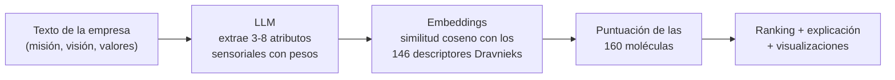
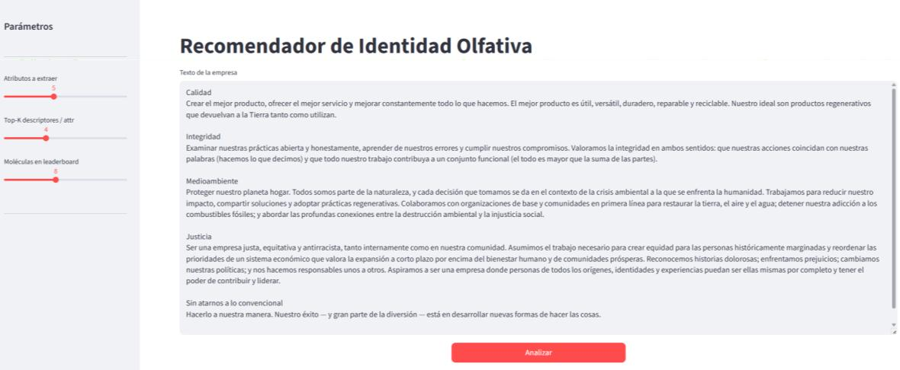
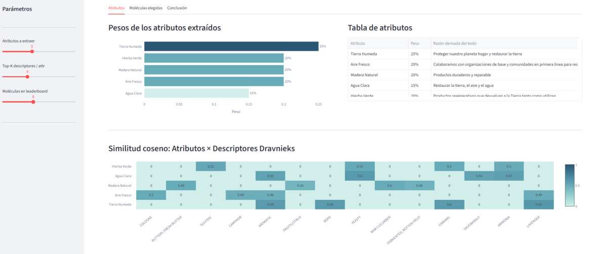
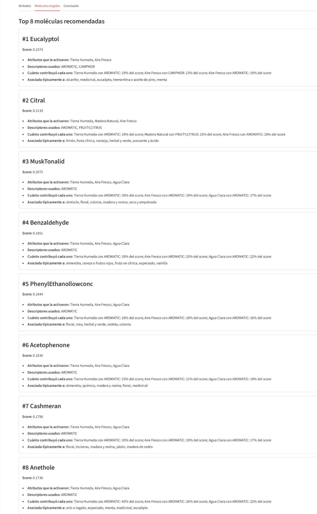
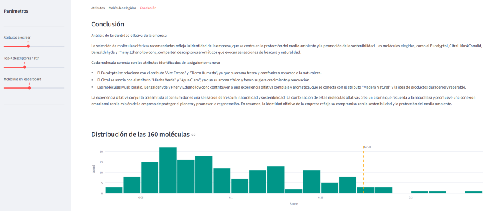
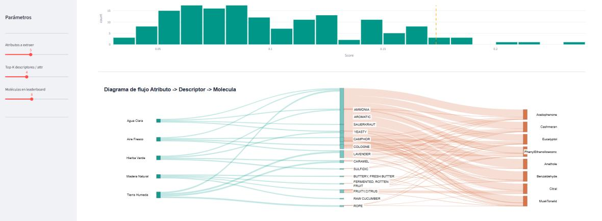

# scent-recommender

**De la identidad de marca al odotipo: un sistema de apoyo a la decisión que traduce la descripción de una empresa en un ranking de moléculas olfativas coherentes con su identidad.**

Trabajo de Fin de Grado (9/10) · Grado en Empresa y Tecnología · Universidade de Santiago de Compostela · Fátima Goldar Pérez · Julio 2026

**[Leer la tesis completa (PDF)](tesis/GoldarPerez_Fatima_TFG.pdf)**

---

## Qué es

El marketing olfativo es una herramienta de diferenciación cada vez más usada en tiendas, hoteles y espacios comerciales. Sin embargo, **elegir el aroma de una marca sigue siendo un proceso muy subjetivo**: normalmente depende de la intuición del equipo de marketing o del catálogo del proveedor, y casi no existen herramientas que conecten lo que una empresa quiere transmitir con estímulos olfativos concretos.

Este repositorio contiene un prototipo que hace esa conexión de forma estructurada:

- **Entrada:** un texto libre de la empresa (misión, visión, valores o cualquier descripción de su identidad).
- **Salida:** un ranking de moléculas olfativas, explicado y trazable hasta los datos experimentales de los que procede.

El sistema **no sustituye al perfumista ni entrega una fragancia terminada**. Ofrece un punto de partida técnicamente fundamentado, reproducible y coherente con la marca, que un experto puede usar como base para desarrollar el odotipo (el aroma distintivo de la marca).

## La idea clave

El diseño separa las responsabilidades para que las recomendaciones sean **trazables**:

| Componente | Qué hace | Qué **no** hace |
|---|---|---|
| Modelo de lenguaje (LLM) | Interpreta el texto y extrae atributos sensoriales con su peso | No elige las moléculas |
| Embeddings semánticos | Conectan cada atributo con los descriptores olfativos más próximos | No inventan asociaciones |
| Dataset Dravnieks (1985) | Aporta datos experimentales reales de percepción olfativa | — |
| Algoritmo de puntuación | Calcula el ranking final de moléculas | — |

Como la recomendación la calcula el algoritmo sobre datos empíricos, y no el criterio interno del LLM, cada molécula del ranking puede rastrearse hasta los atributos y descriptores que la activaron.

## Cómo funciona



1. **Extracción de atributos.** El texto se envía a un LLM (`llama-3.3-70b-versatile` vía Groq), que devuelve entre 3 y 8 atributos sensoriales (por ejemplo, *Tierra húmeda* o *Aire fresco*), cada uno con un peso y la frase del texto que lo justifica. Los pesos suman 1.
2. **Traducción semántica.** Cada atributo se convierte en un vector de 384 dimensiones con `paraphrase-multilingual-MiniLM-L12-v2` y se compara con los 146 descriptores olfativos del dataset mediante similitud del coseno. Para cada atributo se seleccionan los *K* descriptores más próximos.
3. **Puntuación de moléculas.** Para cada una de las 160 moléculas se suman las contribuciones de todos los pares atributo–descriptor:

   ```text
   contribución = peso_atributo × coseno(atributo, descriptor) × (puntuación_Dravnieks / 100)
   ```

4. **Explicación.** El LLM recibe el ranking ya calculado y redacta por qué esas moléculas encajan con la identidad de la marca.
5. **Presentación.** Una interfaz en Streamlit muestra el resultado en tres pestañas: atributos, moléculas y conclusión.

### Base de conocimiento: el dataset Dravnieks (1985)

Es una referencia científica consolidada en investigación olfativa, disponible a través de la librería `pyrfume`. Recoge los resultados de paneles de evaluadores humanos: para **160 moléculas reales** y **146 descriptores olfativos** (*fruity*, *floral*, *woody*, *camphor*…), indica qué porcentaje de panelistas asoció cada molécula con cada descriptor. Se eligió porque son datos cuantitativos de estudios controlados, no asociaciones elaboradas a mano.

## Caso de estudio: Patagonia

Para validar el sistema se usaron como entrada los valores fundamentales publicados por Patagonia: calidad, integridad, compromiso medioambiental, justicia y hacer las cosas de forma diferente. La configuración fue de 5 atributos, 4 descriptores por atributo y un ranking de 8 moléculas.



### 1. Atributos extraídos

El LLM extrajo **Tierra húmeda (25 %), Hierba verde (20 %), Madera natural (20 %), Aire fresco (20 %) y Agua clara (15 %)**, cada uno con la frase del texto que lo justifica. El mapa de calor muestra qué descriptores activa cada atributo.



### 2. Moléculas recomendadas

| # | Molécula | Score | Asociada típicamente a |
|---|---|---|---|
| 1 | Eucalyptol | 0.2374 | alcanfor, eucalipto, aceite de pino, menta |
| 2 | Citral | 0.2133 | limón, cítricos, herbal y verde |
| 3 | MuskTonalid | 0.2072 | almizcle, floral, madera y resina |
| 4 | Benzaldehyde | 0.1851 | almendra, frutos rojos, especiado |
| 5 | PhenylEthanol (baja conc.) | 0.1844 | floral, rosa, herbal y verde |
| 6 | Acetophenone | 0.1830 | almendra, madera y resina, floral |
| 7 | Cashmeran | 0.1796 | incienso, madera de cedro, jabón |
| 8 | Anethole | 0.1736 | anís, especiado, menta |

Para cada molécula, la app indica qué atributos y descriptores la activaron y qué porcentaje del score aportó cada par.

<details>
<summary>Ver la pestaña completa de moléculas</summary>



</details>

### 3. Conclusión y trazabilidad

El sistema identifica un perfil **fresco, herbáceo y natural**, coherente con el compromiso medioambiental de la marca. El histograma confirma que las 8 moléculas elegidas se separan claramente del resto de la distribución.



El diagrama Sankey muestra el recorrido completo, **atributo → descriptor → molécula**: el grosor de cada flujo indica su peso en el cálculo.



Un perfumista podría tomar las notas herbáceas y cítricas como núcleo de una firma olfativa "fresca y natural" para la marca y ajustar después proporciones e ingredientes según su criterio.

## Estructura del repositorio

```text
.
├── 01_setup_dravnieks.ipynb       # Carga Dravnieks (pyrfume) y genera los embeddings de los descriptores (se ejecuta una vez)
├── 02_matching_empresa.ipynb      # Pipeline completo de recomendación, paso a paso
├── 03_streamlit_app.py            # Aplicación web interactiva
├── descriptor_embeddings.npy      # Vectores de los 146 descriptores (146 × 384)
├── descriptor_list.csv            # Lista de descriptores en el mismo orden
├── dravnieks_behavior_named.csv   # Matriz molécula × descriptor (0-100)
├── resultado_*.csv / .txt         # Ejemplo de salida del pipeline
├── requirements.txt
├── docs/img/                      # Figuras del caso de estudio
└── tesis/                         # Memoria del TFG en PDF
```

## Cómo ejecutarlo

Requisitos: Python 3.10 o superior y una clave de API.

```bash
python -m venv .venv
.\.venv\Scripts\Activate.ps1        # Windows PowerShell  (macOS/Linux: source .venv/bin/activate)
pip install -r requirements.txt
```

Crea un archivo `.env` en la raíz del proyecto:

```env
GROQ_API_KEY=tu_clave_API
```

Lanza la aplicación:

```bash
streamlit run 03_streamlit_app.py
```

Se abrirá en `http://localhost:8501`. Pega la descripción de una empresa, ajusta en la barra lateral el número de atributos, de descriptores por atributo y de moléculas, y pulsa **Analizar**.

> La primera ejecución tarda más porque descarga el modelo de embeddings. Los datos de Dravnieks y los embeddings ya vienen incluidos, así que no hace falta ejecutar el notebook 01.

## Alcance y limitaciones

Este es un **prototipo académico**, no un producto en producción. En concreto:

- **No hay filtro sectorial.** La similitud semántica refleja proximidad lingüística, no siempre una asociación olfativa deseable: para una marca costera podría puntuar alto un descriptor como *fishy*.
- **Universo cerrado de 160 moléculas.** Dravnieks se publicó en 1985, así que muchas moléculas de la perfumería actual no están representadas.
- **Depende de la calidad del texto de entrada.** Una descripción vaga produce atributos poco precisos.
- **La validación es cualitativa**, sobre un único caso real. Falta compararla con el criterio de perfumistas o profesionales del marketing olfativo.

**Líneas futuras:** capa de validación por sector, ponderación más refinada, validación con expertos, ampliación con otros datasets de percepción olfativa, un asistente que guíe la redacción del texto de entrada y la incorporación de datos de comportamiento real de consumidores.

## Tecnologías

Python · Streamlit · Groq (Llama 3.3 70B) · sentence-transformers · Qdrant (en memoria) · pandas · NumPy · Plotly · pyrfume

## Créditos

- Datos olfativos: Dravnieks, A. (1985). *Atlas of Odor Character Profiles*, a través de [pyrfume](https://github.com/pyrfume/pyrfume-data).
- Modelo de embeddings: [`paraphrase-multilingual-MiniLM-L12-v2`](https://huggingface.co/sentence-transformers/paraphrase-multilingual-MiniLM-L12-v2) (Reimers y Gurevych, 2019).
- La bibliografía completa está en la [tesis](tesis/GoldarPerez_Fatima_TFG.pdf).

---

**Contacto:** [fatimagp04@gmail.com](mailto:fatimagp04@gmail.com) · [LinkedIn](https://www.linkedin.com/in/fatima-goldar-perez)
